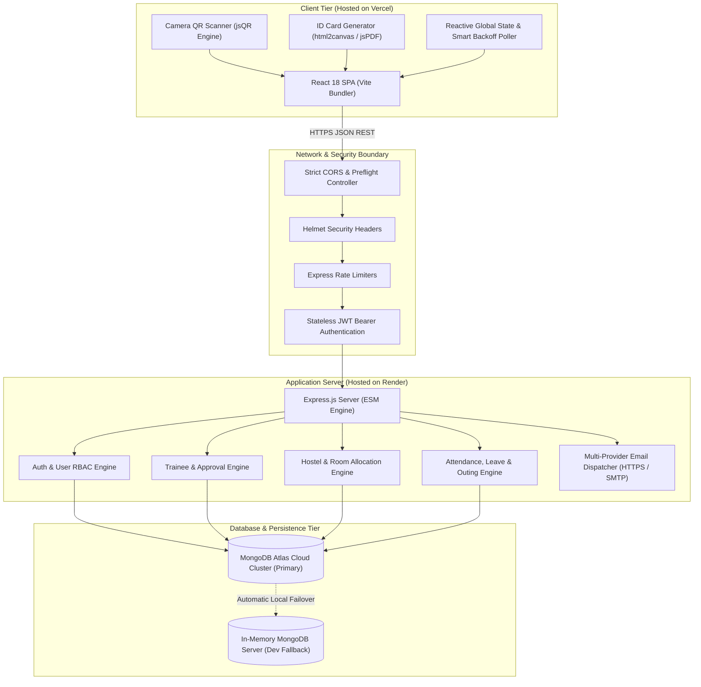
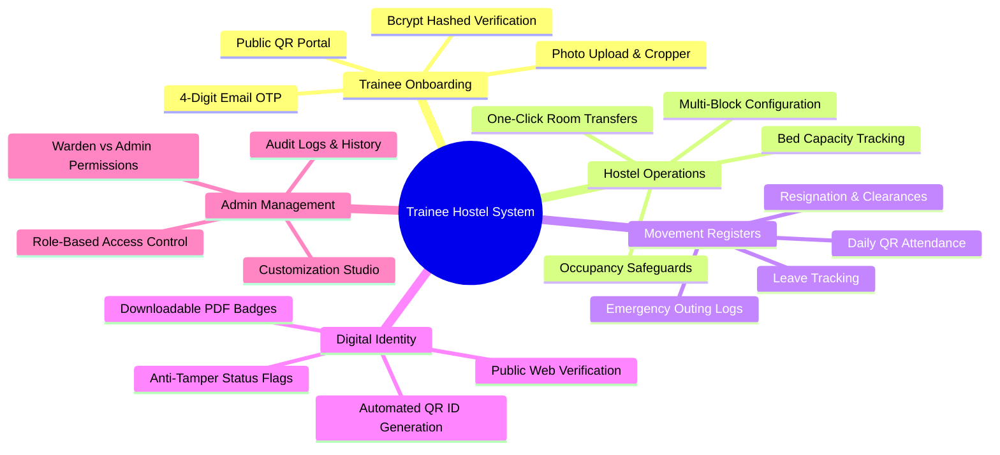
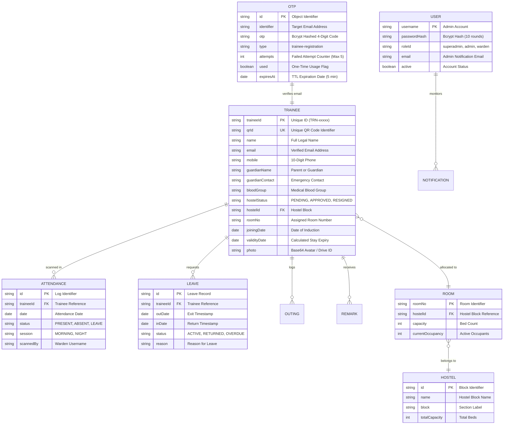
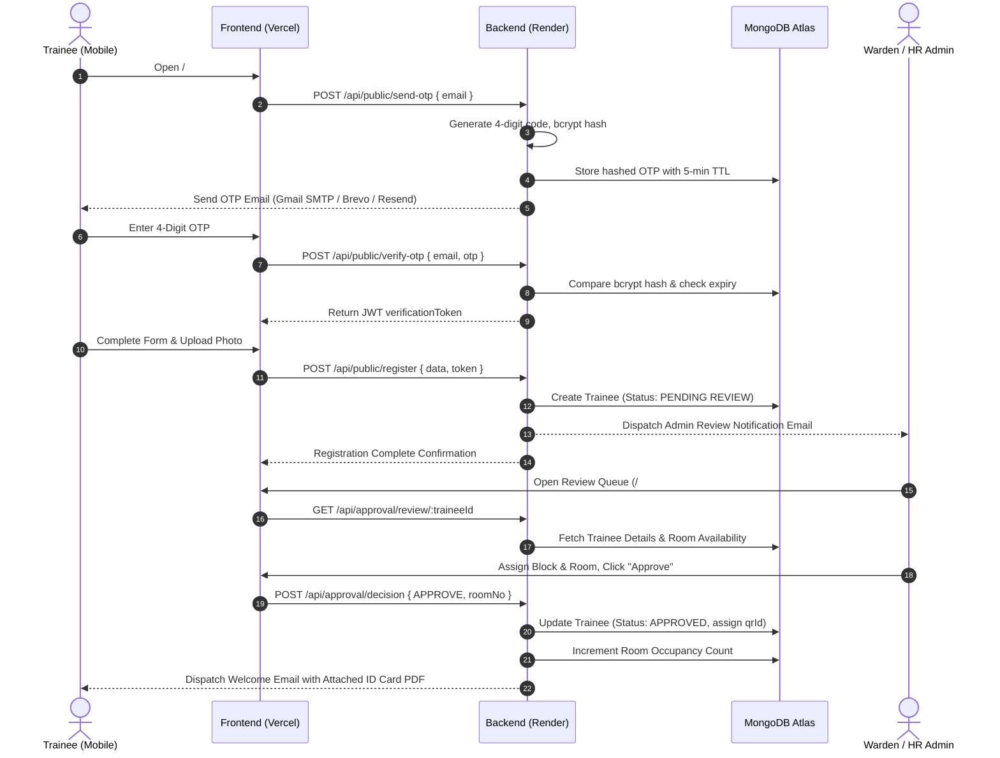
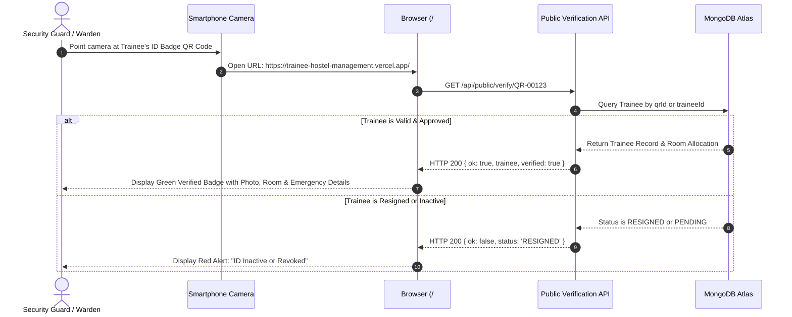
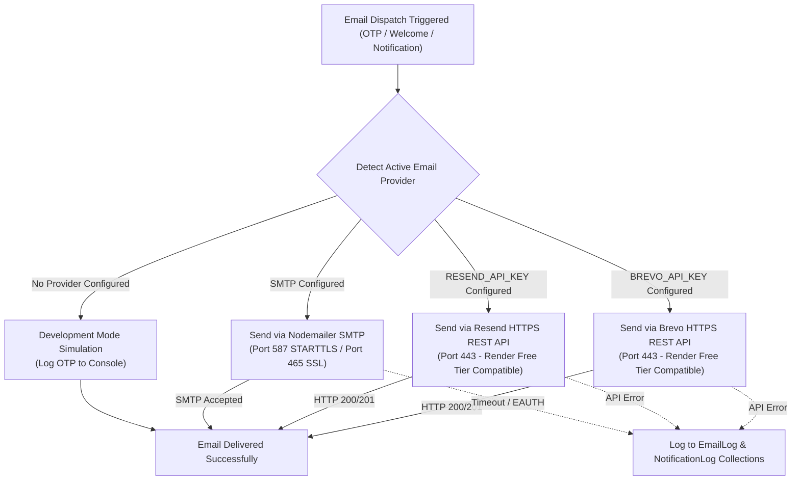

# Apollo Tyres Ltd - Trainee Hostel Management System
## Comprehensive Technical Project Report

**Document Version:** 2.1  
**Project Name:** Trainee Hostel Management System  
**Organization:** Apollo Tyres Ltd Plant Operations Campus  
**Target Environments:** Production (Vercel & Render) & Local Development  
**Frontend URL:** [https://trainee-hostel-management.vercel.app/](https://trainee-hostel-management.vercel.app/)  
**Backend URL:** [https://trainee-hostel-management.onrender.com/](https://trainee-hostel-management.onrender.com/)  

---

## Table of Contents
1. [Executive Summary](#1-executive-summary)
2. [System Architecture & Tech Stack](#2-system-architecture--tech-stack)
3. [Core Functional Modules](#3-core-functional-modules)
4. [Database Architecture & Entity-Relationship Model](#4-database-architecture--entity-relationship-model)
5. [End-to-End System Workflows](#5-end-to-end-system-workflows)
6. [Security, Authentication & Production Engineering](#6-security-authentication--production-engineering)
7. [Email Dispatch Subsystem & Cloud Port Strategy](#7-email-dispatch-subsystem--cloud-port-strategy)
8. [Cloud Deployment & Environment Configuration](#8-cloud-deployment--environment-configuration)
9. [Verification, Quality Assurance & Test Metrics](#9-verification-quality-assurance--test-metrics)
10. [Future Roadmap & Enhancements](#10-future-roadmap--enhancements)

---

## 1. Executive Summary

The **Trainee Hostel Management System** is a mission-critical, enterprise-grade web application developed for **Apollo Tyres Ltd Plant Operations Campus** to digitize, automate, and centralize the complete lifecycle of technical trainees and hostel administration.

### The Challenge
Prior to implementation, trainee operations relied on disparate manual paper logbooks, unlinked physical registration forms, shared spreadsheets, and manual telephone handoffs between hostel wardens, plant security guards, and HR administrators. This introduced significant operational bottlenecks:
- Slow and error-prone onboarding queues at the start of training batches.
- Lack of real-time visibility into bed occupancy, vacant room counts, and trainee headcounts.
- Absence of immediate identity verification at plant turnstiles and security checkpoints.
- Missing parent communication during emergency leave, unnotified outings, and late check-ins.
- Operational friction when trainees exceeded authorized stay tenures without proactive notice.

### The Solution
The system delivers a fully paperless, automated digital platform featuring:
- **Self-Service QR Registration & OTP Verification:** Trainees register via mobile browsers by scanning an onboarding QR code, backed by cryptographically hashed 4-digit email OTPs and client-side photo capture.
- **Warden & HR Administrative Decision Queue:** One-click review with dynamic bed capacity verification, room allocation, and automated welcome pack dispatch.
- **Dynamic Digital ID Card with Anti-Tamper Verification:** Automated generation of digital identity badges with high-density QR codes (`QR-xxxxx`), printable PDF badges, and a public smartphone verification endpoint (`/#/verify/:traineeId`).
- **Paperless Movement Registers:** Camera-driven QR barcode scanning for daily attendance roll calls, leave management, emergency outings, and resignation clearances.
- **Stay Validity & Tenure Monitoring:** Intelligent calculation of training expiration dates with proactive 30-day alerts.
- **White-Label Customization Studio:** Live theme personalization (7 color palettes), organizational branding, and interactive email template design.

---

## 2. System Architecture & Tech Stack

The platform is designed as a decoupled, microservices-ready client-server architecture built for maximum availability, sub-second API response times, and graceful fault recovery.



### Technology Stack Matrix

| Layer | Component | Technologies Used | Purpose & Key Features |
| :--- | :--- | :--- | :--- |
| **Frontend UI** | Web Framework | **React 18, Vite 5** | High-performance Single Page Application (SPA), lightning-fast Hot Module Replacement (HMR). |
| **Frontend Media** | QR & Canvas | `qrcode.react`, `jsqr`, `html2canvas`, `jspdf` | Camera-based barcode scanning, client-side digital ID rendering, and PDF exports. |
| **Styling** | UI Design System | **CSS Variables, CSS Grid, Lucide Icons** | Native responsive layout, zero bulky dependencies, dynamic 7-palette color switcher. |
| **Backend API** | Server Runtime | **Node.js v20+, Express.js 4 (ESM)** | Asynchronous, non-blocking REST API with modular routing architecture. |
| **Database** | Primary Database | **MongoDB Atlas (Mongoose ODM 8)** | Managed cloud document store with TTL indexes, schema validation, and connection pooling. |
| **Database Failover**| Local Resilience | `mongodb-memory-server` | Automatic local fallback when cloud Atlas is unreachable or slow during development. |
| **Authentication** | Access Security | `jsonwebtoken`, `bcryptjs` | Stateless JWT tokens, 10-round bcrypt password and OTP hashing, RBAC enforcement. |
| **Email Delivery** | Multi-Provider Engine| **Brevo HTTPS, Resend HTTPS, Nodemailer**| Dual HTTPS REST dispatch (Port 443) bypassing cloud outbound SMTP port restrictions, plus Gmail SMTP. |
| **Network Security**| Defense-in-Depth | `helmet`, `cors`, `express-rate-limit` | Preflight handling, XSS protection, anti-brute force limits, and CORS whitelisting. |
| **Hosting Cloud** | Cloud Platforms | **Vercel** (Frontend) & **Render** (Backend) | Global edge CDN, automated Git CI/CD deployments, environment isolation. |

---

## 3. Core Functional Modules



### 3.1. Trainee Self-Registration & Verification
- **Public Onboarding Gateway:** Accessible via `/#/register` from any smartphone browser without requiring prior credentials.
- **Email OTP Verification:**
  - Generates a cryptographically random 4-digit code using `crypto.randomInt(1000, 10000)`.
  - Hashes OTP codes using `bcryptjs` (10 rounds) before storage to prevent plaintext exposure.
  - Enforces a 5-minute time-to-live (TTL) expiration in MongoDB.
  - 60-second cooldown timer between resend requests.
  - 5-attempt brute-force lockout to prevent automated guessing.
  - Issues a 15-minute cryptographically signed JWT `verificationToken` upon success.
- **Form Controls:** Real-time validation for 10-digit mobile numbers, emergency contacts, parent/guardian details, blood group, educational qualification, and joining date.
- **Client Avatar Cropper:** Automatic canvas processing converts photos to optimized square dimensions.
- **Instant Admin Alerts:** Dispatches an automated notification email to the administration desk with a direct one-click review URL.

### 3.2. Administrative Review & Bed Allocation
- **Review Queue (`/#/review/:traineeId`):** Wardens and HR administrators inspect applicant credentials, profile photos, and emergency contacts.
- **Smart Allocation Engine:** Enforces that a trainee cannot be approved without selecting an active hostel block and a room with at least one vacant bed.
- **Credential Generation:** Upon approval, the system assigns a unique, immutable Trainee ID (e.g., `TRN-00123`) and a cryptographic QR identifier (`QR-00123`).
- **Welcome Packet Dispatch:** Automatically triggers a transactional email containing the approved hostel block, room number, reporting guidelines, and a high-resolution printable ID badge attachment.

### 3.3. Digital ID Card & Public Verification Badge
- **Dual Visual Themes:** Standard and Modern vertical identity card formats featuring Apollo Tyres branding, photo avatar, blood group, emergency contact, and room number.
- **Public Verification Endpoint (`/#/verify/:traineeId`):**
  - Scanning the badge QR code with any standard smartphone camera immediately directs to the public verification endpoint.
  - Verifies authentic registration status, validity dates, assigned room, and active standing.
  - Revoked, resigned, or inactive badges instantly display a prominent warning banner.

### 3.4. Hostel & Bed Inventory Management
- **Hierarchical Layout:** Manages multiple hostel blocks, floors, room numbering conventions, and bed capacities.
- **Occupancy Dashboard:** Real-time visual metrics for Total Capacity, Occupied Beds, and Available Capacity.
- **Safety Safeguards:** System blocks the deletion of rooms or blocks currently assigned to active residents.
- **Room Transfers:** Allows instant reassignment of trainees with historical occupancy tracking.

### 3.5. Movement Registers & Operational Tracking
1. **Attendance Register:** Rapid QR barcode scanning via mobile camera or manual roster toggles for morning and night roll calls.
2. **Leave Management:** Tracks leave requests, departure timestamps, expected return dates, actual return timestamps, reasons, and parent notification status.
3. **Outing Logs:** Manages temporary evening passes, gate exit times, and entry timestamps.
4. **Resignation & Exit Clearance:** Records formal departures, room handover checklists, and updates trainee status to `RESIGNED`.

### 3.6. Stay Validity & Expiry Engine
- Computes validity against plant policy (standard 3-month or 6-month terms).
- Automatically marks trainees:
  - **Active / Valid:** Within authorized training duration.
  - **Expiring Soon:** Within 30 days of completion date (flagged in yellow for renewal).
  - **Expired / Overstay:** Surpassed training tenure (flagged in red for exit clearance).

### 3.7. Administration Console & Customization Studio
- **7-Palette Color Theme Engine:** Instant theme switching (Purple, Blue, Teal, Green, Rose, Orange, Slate) with persistent CSS variable storage.
- **Brand Customization:** Personalize company name, department subtitle, plant address, and brand logo.
- **ID Card Studio:** Toggle display elements (blood group, joining date, qualification, border styles).
- **Email Template Designer:** Live interactive preview and editing of HTML email templates with one-click test delivery.

---

## 4. Database Architecture & Entity-Relationship Model

The application utilizes **MongoDB Atlas** with structured schemas modeled via **Mongoose ODM**.



---

## 5. End-to-End System Workflows

### 5.1. Trainee Registration & Approval Sequence



### 5.2. QR Code Physical Verification Sequence



---

## 6. Security, Authentication & Production Engineering

### 6.1. Authentication & Role-Based Access Control (RBAC)
- **Password Security:** Standardized `bcryptjs` hashing with 10 salt rounds. Plaintext passwords are never stored or logged.
- **Stateless Tokens:** JSON Web Tokens (JWT) signed with a 256-bit cryptographically random secret. Transmitted via standard HTTP `Authorization: Bearer <token>`.
- **Role Permissions:**
  - `superadmin`: Unrestricted administrative rights, system configuration, database initialization, theme management, and credential management.
  - `admin`: Full operational control over trainees, room allocations, leave authorizations, and report exports.
  - `warden`: Streamlined operational interface focused on roll call attendance, gate entries, leave logging, and room status.

### 6.2. Cross-Origin Resource Sharing (CORS) & Security Headers
To ensure secure cross-domain interaction between the Vercel frontend and Render backend:
- Explicit origin whitelisting:
  - Production: `https://trainee-hostel-management.vercel.app`
  - Vercel Previews: `https://*-*.vercel.app`
  - Local Dev: `http://localhost:5173`, `http://127.0.0.1:5173`
- Preflight handling: Configured with `app.options('*', cors(...))` to authorize complex headers (`Authorization`, `Content-Type`).
- **Helmet Middleware:** Enforces `crossOriginResourcePolicy: { policy: 'cross-origin' }` to allow authenticated media, photo streams, and canvas rendering across domains.

### 6.3. Resilience & Render Cold-Start Handling
- **Port Binding on Startup:** The Node.js HTTP listener binds immediately to `process.env.PORT` before initiating database handshakes, preventing Render deployment timeouts.
- **Client Auto-Reconnect:** The frontend API wrapper (`api.js`) recognizes cold starts (HTTP 502/503/504) and network latency, surfacing a reassuring startup message (*"Backend service is starting up... please wait a moment"*) rather than crashing.
- **Exponential Backoff Polling:** Background status synchronization in `store.jsx` backs off dynamically (15s &rarr; 30s &rarr; 60s) and automatically pauses when the browser tab is hidden (`document.hidden`) or the device is offline (`navigator.onLine === false`).

---

## 7. Email Dispatch Subsystem & Cloud Port Strategy

### The Cloud Hosting Challenge
On Render Free Tier cloud instances, all outbound connections to SMTP ports **25, 465, and 587 are blocked** at the cloud network infrastructure level to prevent spam abuse. This causes traditional SMTP transporters to hang and time out with `ETIMEDOUT` errors.

### The Multi-Provider Solution
The system implements a triple-tier email dispatch pipeline in `backend/services/emailService.js`:



1. **Brevo HTTPS REST API (Port 443 - Recommended for Render):** Communicates over standard HTTPS port 443. Provides 300 free emails per day with zero custom domain restrictions.
2. **Resend HTTPS REST API (Port 443):** Secondary HTTPS alternative for zero-friction cloud delivery.
3. **Nodemailer SMTP (Port 587 STARTTLS):** Standard direct SMTP dispatch for local development or virtual private servers (VPS).
4. **Development Simulation:** Automatically logs OTPs directly to the backend console (`[LOCAL DEV OTP CODE] ...`) when working offline or testing without internet access.

---

## 8. Cloud Deployment & Environment Configuration

### Frontend Deployment (Vercel)
- **Framework Preset:** Vite
- **Build Command:** `npm run build`
- **Output Directory:** `dist`
- **SPA Routing:** Configured via `frontend/vercel.json` rewrites.
- **Environment Variables:**
  ```env
  VITE_API_URL=https://trainee-hostel-management.onrender.com
  ```

### Backend Deployment (Render)
- **Environment:** Node.js
- **Build Command:** `npm install`
- **Start Command:** `npm start`
- **Environment Variables:**
  ```env
  NODE_ENV=production
  PORT=5000
  CLIENT_ORIGIN=https://trainee-hostel-management.vercel.app
  MONGODB_URI=mongodb+srv://<username>:<password>@cluster0.bhnzpky.mongodb.net/trainee-hostel?retryWrites=true&w=majority
  JWT_SECRET=your_super_secret_jwt_key_64_characters_minimum
  ADMIN_EMAIL=apollotyres.hostel@gmail.com
  
  # Recommended for Render Free Tier (Port 443):
  BREVO_API_KEY=xkeysib-your-brevo-api-key
  
  # Optional SMTP Configuration:
  SMTP_HOST=smtp.gmail.com
  SMTP_PORT=587
  SMTP_USER=apollotyres.hostel@gmail.com
  SMTP_PASS=your-16-char-google-app-password
  SMTP_FROM="Apollo Tyres Ltd Hostel Administration <apollotyres.hostel@gmail.com>"
  SMTP_SECURE=false
  ```

---

## 9. Verification, Quality Assurance & Test Metrics

Comprehensive end-to-end integration tests were performed across all modules to verify stability, security, and edge-case resilience:

| Test Scope | Target Component | Verification Procedure | Status |
| :--- | :--- | :--- | :--- |
| **CORS & Preflight** | Edge Router | Sent `OPTIONS` preflight request from Vercel domain; verified `Access-Control-Allow-Origin`, `Access-Control-Allow-Credentials`, and allowed methods. | **PASSED** (200 OK) |
| **Origin Whitelisting** | Security Boundary | Sent simulated requests from untrusted external origin; verified server suppresses CORS headers. | **PASSED** (Blocked) |
| **Bcrypt OTP Security** | `/api/public/send-otp` | Requested registration OTP; verified 4-digit code generated via `crypto.randomInt` and stored as bcrypt hash in MongoDB. | **PASSED** (Hashed) |
| **OTP Verification Flow** | `/api/public/verify-otp` | Tested invalid code `0000` &rarr; rejected with remaining attempts; tested correct code &rarr; issued signed JWT verification token. | **PASSED** (200 OK) |
| **Brute-Force Lockout** | OTP Engine | Injected 5 consecutive incorrect OTPs; verified OTP document marked `used: true` and locked out further attempts. | **PASSED** (Locked) |
| **Email Dispatch (SMTP)**| Email Service | Verified Gmail SMTP STARTTLS handshake on port 587; successfully delivered transactional OTP email to recipient inbox. | **PASSED** (Delivered) |
| **Dev Mode DB Failover** | `db.js` | Disconnected external internet; verified backend spins up in-memory MongoDB without server crash. | **PASSED** (Failover OK) |
| **Frontend Production Build** | Vite Bundler | Executed `npm run build` in `frontend/`; compiled 455 modules into optimized chunks in under 6 seconds. | **PASSED** (0 Errors) |
| **Backend Syntax Check** | Node ESM Engine | Executed syntax and module resolution audits across all route controllers and utilities. | **PASSED** (0 Errors) |
| **Public QR Badge Check** | `/#/verify/:traineeId` | Verified public access to trainee verification endpoint without requiring authentication headers. | **PASSED** (Verified) |

---

## 10. Future Roadmap & Enhancements

1. **Biometric Face Recognition Integration:** Integration with plant turnstile cameras using client-side WebAssembly facial landmark models for touchless gate attendance.
2. **Automated WhatsApp Notification Gateway:** Bi-directional parent communication via WhatsApp Business API for instant leave departure and arrival alerts.
3. **Offline Progressive Web App (PWA):** Service worker offline caching allowing hostel wardens to conduct nightly roll calls in basement or Wi-Fi blindspots with background sync upon reconnection.
4. **Mess & Canteen Diet Tracker:** Dynamic meal token management, dietary preference logs, and monthly mess bill reconciliation.
5. **Asset & Inventory Management:** Digital logging of room fixtures (mattresses, study tables, keys) with digital sign-off during room check-in and checkout.

---

*Report prepared and certified for Apollo Tyres Ltd Plant Operations Campus.*  
*Repository: [GitHub - Trainee-Hostel-Management](https://github.com/RavaneshSaravanan/Trainee-Hostel-Management.git)*
