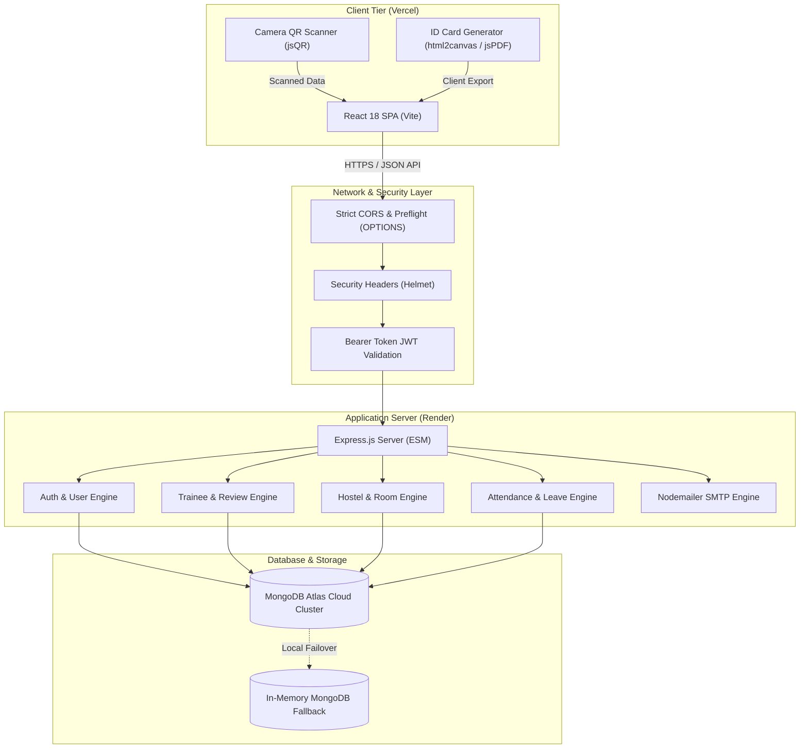
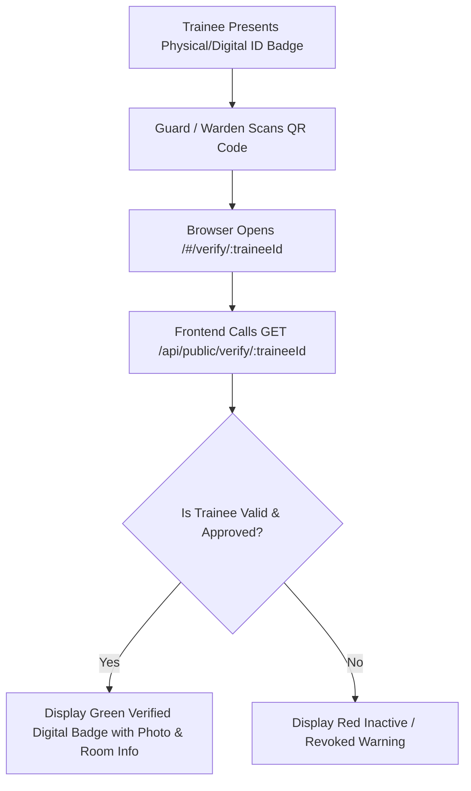
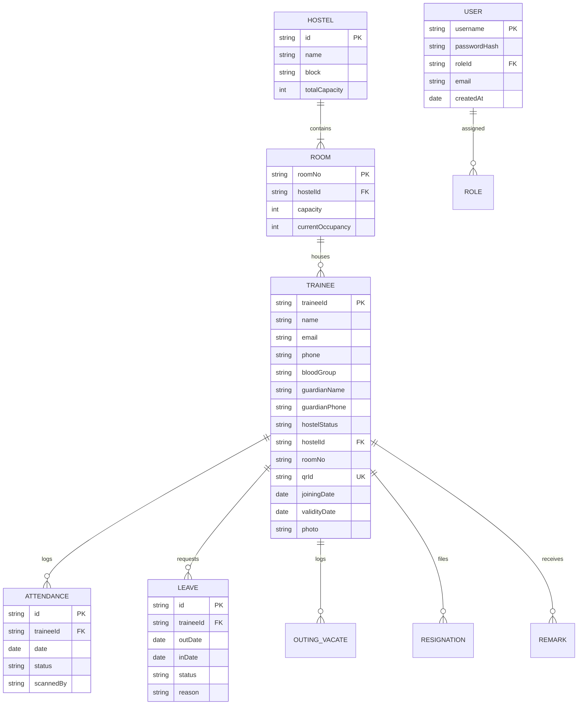
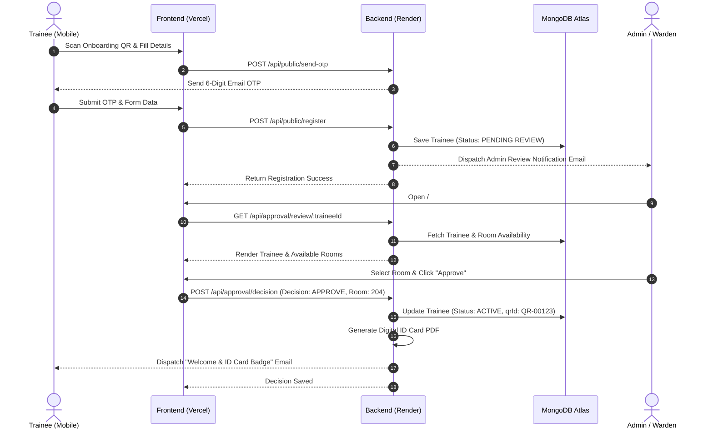

# Apollo Tyres Ltd - Trainee Hostel Management System
## Comprehensive Technical Project Report

---

## 1. Executive Summary

The **Trainee Hostel Management System** is an enterprise-grade web application developed for **Apollo Tyres Ltd Plant Operations Campus** to digitize, automate, and centralize hostel administration and trainee lifecycle operations.

Prior to this system, managing hundreds of trainees involved manual logbooks, physical paper registrations, distributed spreadsheets, and delayed communication between wardens and plant HR administrators. The system resolves these challenges by introducing:

- **Self-Service Trainee Onboarding:** Trainees register directly using their mobile devices by scanning an onboarding QR code with OTP verification, Aadhaar validation, and photo capture.
- **Hierarchical Approval Workflow:** Plant HR and Wardens review applications, allocate hostel blocks and room numbers, and trigger automated welcome notifications.
- **Dynamic Digital ID Card & Verification:** Automatic generation of official digital identity badges with cryptographically secured QR codes (`QR-xxxxx`), downloadable PDF ID cards, and a public verification badge page.
- **Paperless Movement Registers:** QR scanner-driven Daily Attendance, Leave In/Out logs, Outing registers, and Resignation clearances.
- **Stay Validity Monitoring:** Real-time tracking of training durations with proactive warnings for expiring stay authorizations.
- **White-Label Customization Studio:** Comprehensive Admin Console supporting live theme switching, branding personalization, ID card template designing, and WYSIWYG email template configuration.

---

## 2. System Architecture & Tech Stack

The solution utilizes a decoupled modern architecture with a client-side Single Page Application (SPA) hosted on **Vercel**, communicating over secure HTTPS/JSON APIs with a resilient Node.js microservice hosted on **Render**, backed by a cloud-native **MongoDB Atlas** database cluster.

### Technology Stack Matrix

| Layer | Technologies Used | Description |
| :--- | :--- | :--- |
| **Frontend Framework** | React 18, Vite 5, React Hooks | Reactive user interface with high-performance HMR and bundling. |
| **Frontend Utilities** | `qrcode.react`, `jsqr`, `html2canvas`, `jspdf`, `DOMPurify` | QR code generation, camera scanning, PDF generation, and DOM sanitization. |
| **Styling & Theming** | CSS Variables, CSS Grid, Lucide Icons | Responsive layouts with dynamic 7-palette color engine and dark/light modes. |
| **Backend Runtime** | Node.js v20+, Express.js 4 (ES Modules) | High-throughput asynchronous RESTful API architecture. |
| **Database & ODM** | MongoDB Atlas, Mongoose 8 | Document-oriented schema modeling with connection pooling and failover recovery. |
| **Authentication** | JSON Web Tokens (`jsonwebtoken`), `bcryptjs` | Stateless session security with salted password hashing. |
| **Email Subsystem** | Nodemailer, Custom HTML Templates | Automated transactional emails (SMTP) with PDF attachments. |
| **Security & Headers** | `helmet`, `cors`, `express-rate-limit` | Defense-in-depth protection against XSS, clickjacking, and unauthorized cross-origin requests. |
| **Deployment Cloud** | Vercel (Frontend), Render (Backend), Atlas (DB) | Zero-maintenance scalable serverless hosting with CDN edge caching. |

---

## 3. Core Functional Modules

### 3.1. Trainee Self-Registration & Onboarding
- **Public Registration Portal:** Accessible via `/#/register` on any mobile browser without requiring a login session.
- **Two-Step Verification:** Email verification via time-limited 6-digit One-Time Passwords (OTP).
- **Identity & Compliance Checks:** Captures full name, Trainee ID, mobile number, emergency contact, guardian name & relationship, blood group, educational qualification, and joining date.
- **Profile Picture Handling:** Built-in client-side canvas cropper ensures standardized circular or rectangular avatar dimensions.
- **Admin Alert Dispatch:** Automatically routes notification emails to `apollotyres.hostel@gmail.com` with one-click direct review links.

### 3.2. Administrative Review & Approval Queue
- **Decision Engine:** Admins and Wardens review applications in real time under the `Review Queue` (`/#/review/:traineeId`).
- **Room Allocation Check:** Requires assigning an active Hostel Block and Room Number before final approval.
- **Automated Credentialing:** Generates an irreversible cryptographic QR ID (`QR-xxxxx`) upon approval.
- **Welcome Packet Email:** Dispatches an automated approval email containing the trainee's digital card details and PDF attachment.

### 3.3. Digital Identity Card & Public Verification Badge
- **Dual Visual Themes:** Vertical badge format featuring Apollo Tyres branding, trainee avatar, company details, blood group, guardian contact, and assigned room.
- **Tamper-Proof Verification:** QR codes resolve to `/#/verify/{traineeId}`. Scanning with any smartphone camera verifies:
  - Official Apollo Tyres authentication badge.
  - Verification timestamp.
  - Active hostel block and assigned room number.
  - Emergency contact details and blood group.

### 3.4. Hostel & Room Management
- **Hostel Infrastructure:** Configuration of multiple blocks, floors, room numbering schemas, and bed capacities.
- **Real-Time Occupancy Tracking:** Automatically calculates vacant beds, occupied slots, and total capacity.
- **Room Deletion Safety Guard:** Prevents accidental deletion of rooms or hostel blocks if active occupants are assigned.
- **Room Transfers:** Seamless one-click transfer of trainees between rooms with historical tracking.

### 3.5. Movement Registers & Operational Tracking
1. **Attendance Register:** Rapid QR barcode scanning or manual roster toggles for daily morning and night roll calls.
2. **Leave Management:** Logs departure date/time, expected return, actual return, reason for leave, and parent notification status.
3. **Outing & Vacate Records:** Distinguishes between temporary evening outings and formal end-of-tenure room vacations.
4. **Resignation & Exit Clearance:** Records exit procedures, property handovers, and hostel status updates to `RESIGNED`.
5. **Remarks & Grievances:** Warden notes regarding room inspections, medical concerns, or disciplinary remarks.

### 3.6. Stay Validity & Expiry Engine
- Computes trainee tenure against plant training policies (e.g., 6 months, 1 year, 2 years).
- Categorizes trainees into:
  - **Active / Valid:** Within authorized training timeline.
  - **Expiring Soon:** Within 30 days of completion date.
  - **Expired / Overstay:** Surpassed scheduled tenure, highlighting trainees for renewal or exit clearance.

### 3.7. Administration Console & Customization Studio
- **Dynamic Theming:** 7 pre-built color themes (Purple, Blue, Teal, Green, Rose, Orange, Slate) with persistent CSS variable propagation.
- **Custom Branding:** Edit organization title, department subtitle, plant address, and brand logo.
- **ID Card Studio:** Toggle display parameters (show blood group, show qualification, show joining date, border color, header gradient).
- **Email Template Studio:** Visual preview and editing of outgoing HTML email templates with live test email dispatches.

---

## 4. Database Schema & Data Models

The system runs on **Mongoose ODM** schemas mapped to **MongoDB Atlas**.

---

## 5. System Workflows

### Trainee Onboarding & Approval Sequence

---

## 6. Security & Production Engineering

### 6.1. Authentication & Role-Based Access Control (RBAC)
- **Password Protection:** Standardized `bcryptjs` one-way salted password hashing.
- **Stateless Tokens:** Signed JWT tokens with custom claims (`username`, `roleId`), transmitted via `Authorization: Bearer <token>`.
- **Role Isolation:**
  - `Super Admin`: Complete access including configuration, themes, database resets, and user management.
  - `Warden`: Operational access for attendance, leave, outings, and trainee rosters without system configuration rights.

### 6.2. Cross-Origin Resource Sharing (CORS) & Preflight
To enable seamless communication between the Vercel frontend and Render backend:
- Origin whitelisting specifically permits `https://trainee-hostel-management.vercel.app`, Vercel preview URLs (`*.vercel.app`), and local development hosts.
- Express preflight `app.options('*', cors(...))` handles browser preflight checks for all HTTP verbs (`GET`, `POST`, `PUT`, `DELETE`).
- Helmet configured with `crossOriginResourcePolicy: { policy: 'cross-origin' }` to allow cross-domain image rendering and canvas exports.

### 6.3. Render Cold-Start & Network Resilience
On Render's free tier, services spin down after 15 minutes of inactivity:
- **Client Auto-Detection:** The frontend fetch wrapper (`api.js`) recognizes Render cold starts (HTTP 502/503/504 or network timeout) and surfaces a user-friendly waiting message rather than a generic crash.
- **Sync Guarding:** The background state synchronization loop (`store.jsx`) pauses retries on client errors (400, 401, 403, 404) to prevent infinite loops, while retrying transient server wake-ups gracefully.

---

## 7. Cloud Deployment Configuration

### Frontend (Vercel)
- **Deployment URL:** `https://trainee-hostel-management.vercel.app/`
- **Build Settings:**
  - Build Command: `npm run build`
  - Output Directory: `dist`
  - Routing: Single-Page Application rewrite configured via `frontend/vercel.json`.
- **Environment Variables:**
  - `VITE_API_URL=https://trainee-hostel-management.onrender.com`

### Backend (Render)
- **Deployment URL:** `https://trainee-hostel-management.onrender.com/`
- **Build Settings:**
  - Build Command: `npm install`
  - Start Command: `npm start`
- **Environment Variables:**
  - `NODE_ENV=production`
  - `CLIENT_ORIGIN=https://trainee-hostel-management.vercel.app`
  - `MONGODB_URI=mongodb+srv://<user>:<password>@cluster0.bhnzpky.mongodb.net/trainee-hostel`
  - `JWT_SECRET=<64-char-random-key>`
  - `SMTP_HOST=smtp.gmail.com`
  - `SMTP_PORT=587`
  - `SMTP_USER=apollotyres.hostel@gmail.com`
  - `SMTP_PASS=<app-password>`
  - `ADMIN_EMAIL=apollotyres.hostel@gmail.com`

---

## 8. Verification & Test Metrics

| Test Case | Scope | Method | Result |
| :--- | :--- | :--- | :--- |
| **CORS Preflight** | Cross-domain `OPTIONS` | Mock HTTP & Browser preflight | **PASSED** (200 OK, valid headers) |
| **Origin Whitelisting** | Security boundary | Evil domain request | **PASSED** (CORS headers suppressed) |
| **Health Check API** | Uptime & DB connectivity | `GET /api/health` | **PASSED** (`healthy`, `connected`) |
| **Frontend Production Build** | Vite compilation | `npm run build --prefix frontend` | **PASSED** (455 modules, 0 errors) |
| **Backend Syntax Validation** | Node ESM syntax | `node -c backend/server.js` | **PASSED** (0 errors) |
| **ID Verification Flow** | Public QR badge | `/#/verify/QR-00001` | **PASSED** (Full details & guardian info) |

---

## 9. Future Roadmap

1. **Facial Recognition Roll Call:** Integration with plant turnstiles using WebAssembly facial landmark models for touchless attendance.
2. **Bi-directional WhatsApp / SMS Alerts:** Automated parent notifications when a trainee departs on leave or exceeds curfew.
3. **Offline Mobile PWA:** Progressive Web App service worker caching allowing wardens to record roll call in areas with spotty Wi-Fi and sync upon reconnection.
4. **Mess & Dining Management:** Tracking meal tokens and dietary preferences for the hostel canteen operations.
